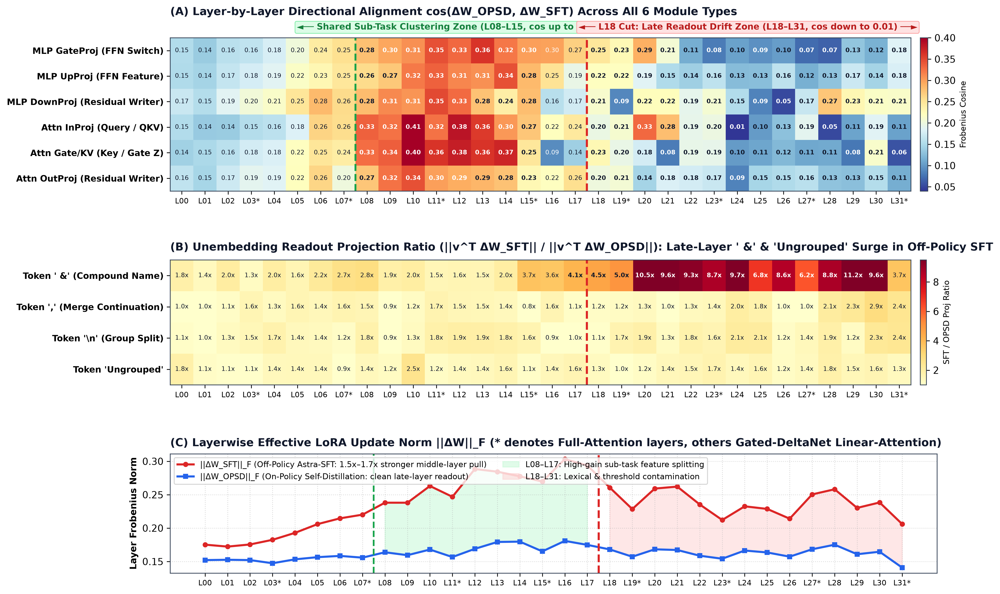
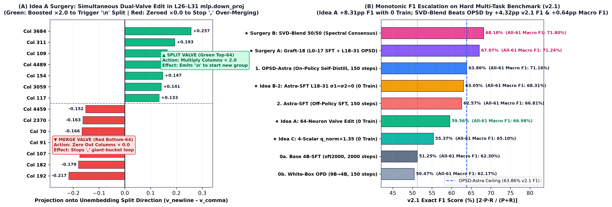

# Weight-Space Anatomy and Zero-Training LoRA Surgery
### Breaking Giant-Bucket Over-Merging Beyond On-Policy Self-Distillation (`Qwen/Qwen3.5-4B`)

**Authors:** Tao Li (`taoli1@microsoft.com`), Qiang Shen (`qiangshen@microsoft.com`), Bo Shao (`boshao@microsoft.com`), Linjun Shou (`lisho@microsoft.com`)

[-ef4444?style=for-the-badge)](./Weight_Space_Surgery_Paper.pdf)
[](./paper/main.tex)
[](./index.html)
[](./FINAL_REPORT.md)

---

## 1. Core Thesis & Contributions

When post-training Small Language Models (SLMs) such as `Qwen/Qwen3.5-4B` (32 layers, 248 LoRA modules, 21.2M float32 parameters) for complex multi-task Browser Tab Grouping (`v2.1`), standard Supervised Fine-Tuning (`0a_sft2000`) and standard White-Box On-Policy Distillation (`0b_opd9b`, 9B→4B) suffer from severe **giant-bucket over-merging** (`51.25%` and `50.47%` `v2.1` F1). While distilling from 1,200 frontier (`GPT-6-astra`) reference solutions via On-Policy Self-Distillation (`1_opsd_astra`) or off-policy SFT (`2_sft_astra`) lifts `v2.1` F1 to `63.86%` and `62.57%`, neither paradigm reaches the true ceiling alone:
- **On-Policy OPSD** preserves clean readout thresholds (`85.48%` Precision on `v1`, `69.09%` on `v2.1`), but its sparse trajectory gradients under-update middle-layer feature splitters.
- **Off-Policy SFT** applies $1.6\times$ stronger updates in middle clustering layers (`L08–L15`), but corrupts late readout layers (`L18–L31`) by memorizing surface lexical artifacts (`' &'`) and aggressive `Ungrouped` thresholds (`-8.33pp` Recall collapse on `v1`).

Inspired by *Weight-Space Programming* ([Takehi et al., 2026](https://rikiyat.github.io/blog/weight-space-programming/)), we perform an exact **32-layer QR-SVD and RMSNorm-Unembedding projection anatomy** of $\Delta W = W - W_0$ without running gradients, uncovering a sharp functional boundary at **Layer 18** and establishing two families of **0-training surgical algorithms**:

1. **Single-Model Dual-Valve Neuron Surgery (`Idea A`, 0 Training, No 2nd Adapter):**
   In layers `L26–L31` `mlp.down_proj` ($[2560, 9216]$), we project all 9,216 columns onto the newline-vs-comma unembedding direction $v_{\text{split}} = \hat{u}_{\texttt{\textbackslash n}} - \hat{u}_{\texttt{,}}$ and simultaneously **boost the green top-64 newline columns by `×2.0`** (opening the split valve) while **zeroing the red bottom-64 comma columns by `×0.0`** (closing the giant-bucket merge valve). With **0 training steps** on base `sft2000`:
   - `v2.1` Recall jumps from **`45.71%` to `57.93%` (`+12.22pp`)** and `v2.1` F1 jumps from **`51.25%` to `59.56%` (`+8.31pp`)**—outperforming 150-step White-Box OPD (`9B→4B`, `50.47%` F1) by **`+9.09pp` F1** and even surpassing 150-step `Astra-SFT` on All-61 Macro F1 (`66.98%` vs. `66.81%`).
2. **Dual-Adapter Circuit Grafting & Rank-16 Spectral Consensus (`Graft-18` & `SVD-Blend 50/50`, 0 Extra Training):**
   Combining SFT's high-gain middle clustering layers (`L00–L17`) with OPSD's uncontaminated readout layers (`L18–L31`), or computing the parameter-free rank-16 SVD consensus $\operatorname{SVD}_{16}(\frac{1}{2}\Delta W_{\text{OPSD}} + \frac{1}{2}\Delta W_{\text{SFT}})$, **strictly dominates both OPSD and SFT**:
   - **`Graft-18`** reaches **`64.52%` Recall / `67.07%` F1 on `v2.1`** (`+5.16pp` Recall, `+3.21pp` F1 over OPSD).
   - **`SVD-Blend 50/50`** achieves **`72.41%` Initial Precision / `64.42%` Recall / `68.18%` F1 on `v2.1`** (`+4.32pp` F1 over OPSD, `+5.61pp` F1 over SFT) and the **highest overall All-61 Macro F1 (`71.80%`)**.

---

## 2. 32-Layer Weight-Space Anatomy (Figure 1)



### Physical Meaning of the 6 Heatmap Rows in Figure 1(A)
Each Transformer layer in `Qwen3.5-4B` contains 6 core functional sub-modules (3 in Attention, 3 in FFN/MLP):
1. **`Attn InProj (Q / QKV)` (Cross-Tab Query Probe):** Projects residual states into search queries (`q_proj` or `in_proj_qkv`), governing *what semantic features a tab searches for* across other tabs. Peaks at $\cos = 0.41$ in `L08–L13`.
2. **`Attn Gate/KV (Z / K)` (Cross-Tab Clustering Latch):** Forms matching keys (`k_proj`) or recurrent gates (`in_proj_z`), deciding *which pairs of tabs bind into the same task cluster*. Peaks at $\cos = 0.40$ in `L08–L14`.
3. **`Attn OutProj` (Attention Residual Writer, $\to 2560$):** Writes aggregated cross-tab context back into the 2,560-dim residual stream.
4. **`MLP GateProj` (FFN Nonlinear Switch, $2560 \to 9216$):** Computes the SiLU gate $\sigma(W_{\text{gate}} h)$ controlling which of the 9,216 FFN intermediate neurons fire.
5. **`MLP UpProj` (FFN Feature Extractor, $2560 \to 9216$):** Extracts candidate semantic representations before elementwise gating.
6. **`MLP DownProj` (Vocabulary Valve Writer, $9216 \to 2560$):** Projects active FFN neurons back to the residual stream; each of its 9,216 columns acts as an atomic writer voting directly on output vocabulary logits (`\n` vs. `,` vs. `' &'`).

---

## 3. Dual-Valve Neuron Surgery & Monotonic F1 Ladder (Figure 2)



---

## 4. Complete Run-1 Evaluation Benchmark (`v2.1` + `v1` Exact F1)

| Category | Model / Surgical Method | Edited Scope | `v2.1` Init P / Recall | `v2.1` F1 | `v1` Init P / Recall | `v1` F1 | All-61 Macro F1 |
| :--- | :--- | :--- | :---: | :---: | :---: | :---: | :---: |
| **Trained Baselines** | `0b_opd9b` (White-Box OPD 9B→4B) | 21.2M (150 steps) | 57.14% / 45.20% | 50.47% | 80.11% / 68.52% | 73.86% | 62.17% |
| **Trained Baselines** | `0a_sft2000` (Base 4B-SFT) | — | 58.33% / 45.71% | 51.25% | 79.23% / 68.26% | 73.34% | 62.30% |
| **Trained Baselines** | `2_sft_astra` (Off-Policy Astra-SFT) | 21.2M (150 steps) | 65.08% / 60.25% | 62.57% | 79.55% / 64.19% | 71.05% | 66.81% |
| **Trained Baselines** | `1_opsd_astra` (On-Policy OPSD-Astra) | 21.2M (150 steps) | 69.09% / 59.36% | 63.86% | **85.48% / 72.52%** | **78.47%** | 71.16% |
| **Single-Model Surgery (0 Train)** | **Idea C**: L07,11,15,19 `q_norm`×1.35 (`sft2000`) | 4 scalars | 59.26% / 51.96% | 55.37% | 79.89% / 70.37% | 74.83% | 65.10% |
| **Single-Model Surgery (0 Train)** | **Idea A**: L26–31 Dual-Valve 64-Col (`sft2000`) | 1.39% MLP cols | 61.29% / **57.93%** | **59.56%** | 79.79% / 69.70% | 74.40% | **66.98%** |
| **Single-Model Surgery (0 Train)** | **Idea B-1**: L18–31 $\sigma_1 = 0$ (`sft_astra`) | 1 scalar/mod | 65.57% / 58.69% | 61.94% | 80.34% / 65.74% | 72.31% | 67.12% |
| **Single-Model Surgery (0 Train)** | **Idea B-2**: L18–31 $\sigma_1=\sigma_2=0$ (`sft_astra`) | 2 scalars/mod | 66.13% / 60.25% | **63.05%** | 80.66% / 67.63% | **73.57%** | **68.31%** |
| **Dual-Adapter Surgery (0 Train)** | `Rev-Graft-18` (`L00–17 OPSD + L18–31 SFT`) | Reverse control | 67.86% / 59.81% | 63.58% | 82.78% / 67.48% | 74.35% | 68.97% |
| **Dual-Adapter Surgery (0 Train)** | `Graft-14` (`L00–13 SFT + L14–31 OPSD`) | Cut @ L14 | 66.10% / 60.33% | 63.08% | 83.33% / 68.37% | 75.11% | 69.10% |
| **Dual-Adapter Surgery (0 Train)** | `Graft-22` (`L00–21 SFT + L22–31 OPSD`) | Cut @ L22 | 65.62% / 61.82% | 63.66% | 80.77% / 68.26% | 73.99% | 68.83% |
| **Dual-Adapter Surgery (0 Train)** | **Surgery A**: `Graft-18` (`L00–17 SFT + L18–31 OPSD`) | Cut @ L18 | 69.84% / **64.52%** | **67.07%** | 82.87% / 69.19% | 75.41% | **71.24%** |
| **Dual-Adapter Surgery (0 Train)** | **Surgery B**: `SVD-Blend 50/50` (Spectral Consensus) | Rank-16 SVD | **72.41% / 64.42%** | **68.18%** | 82.61% / 69.37% | 75.41% | **71.80%** |

---

## 5. Repository Structure

```text
.
├── Weight_Space_Surgery_Paper.pdf       # Compiled 6-page LaTeX paper (with F1 tables & dual-valve figures)
├── FINAL_REPORT.md                      # Detailed Chinese technical & mechanistic report
├── index.html                           # Self-contained interactive dark-theme weight-space dashboard
├── weight-space-surgery-r1.csv          # Complete Run-1 metrics table across all 14 models
├── weight_space_dossier.json            # Full 32-layer x 248-module QR-SVD & unembedding projection data
├── paper/
│   ├── main.tex                         # LaTeX source code
│   ├── main.pdf                         # Compiled PDF
│   └── figures/                         # High-res PDF & PNG figures (Fig 1 Heatmap, Fig 2 Dual-Valve & F1)
├── scripts/
│   ├── run_abc_all.py                   # Single-model weight surgeries (Idea A 64-col valve, Idea B sigma=0, Idea C q_norm)
│   ├── run_surgical_probe2.py           # 32-layer QR-SVD & RMSNorm-Unembedding projection diagnostic script
│   ├── launch_surgical_r1.py            # Dual-adapter surgical synthesis (Graft-14/18/22, Rev-Graft-18, SVD-Blend)
│   ├── train_opsd_astra_4b.py           # On-Policy Self-Distillation (OPSD) trainer
│   └── train_opd_9b_to_4b.py            # White-Box On-Policy Distillation (OPD) trainer
└── data/
    ├── abc_full_r1_results.json         # Per-case outputs & exact scores for all 61 evaluation sessions
    └── complete_viz_bundle.json         # Complete neuron polarity spectrum & case diff bundle
```
